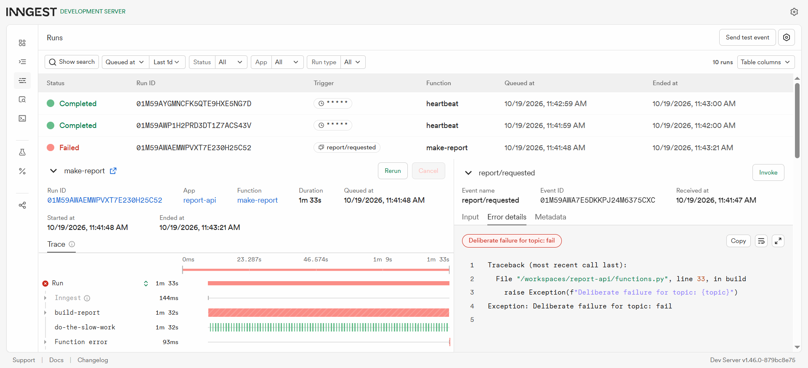
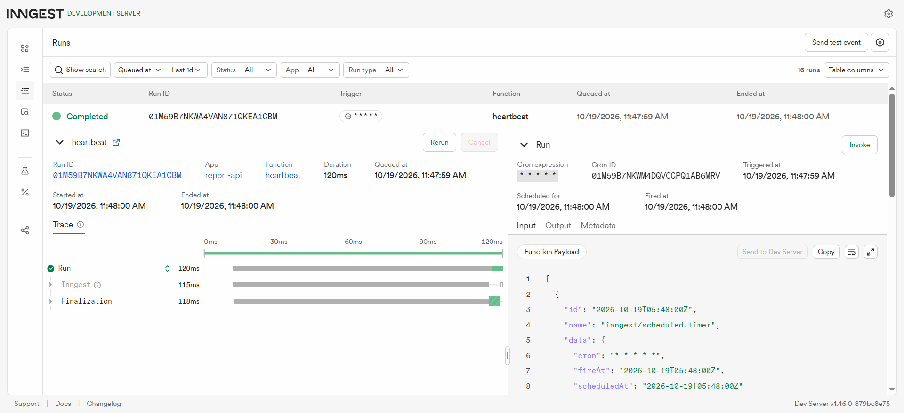
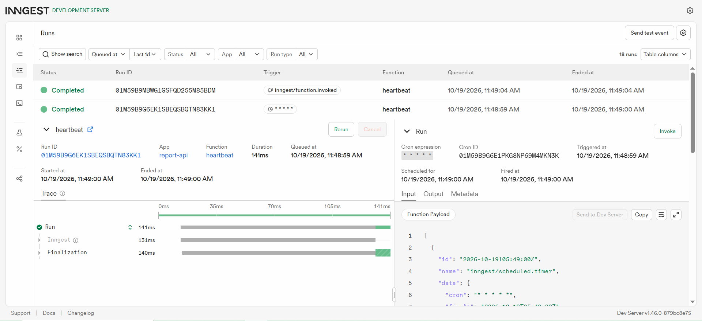

# Report API

A FastAPI backend that demonstrates asynchronous job processing using Inngest. When a report is requested, the API returns immediately with `202 Accepted` and delegates the slow work (8 seconds) to a background job. A status endpoint lets clients poll for completion. A cron job runs every minute to log a summary of all report statuses.

Built as part of the FlyRank AI internship.

## How to run

### 1. Clone and install

```bash
git clone https://github.com/SanjaraT/report-api
cd report-api
python -m venv venv
source venv/bin/activate      # Mac/Linux/Codespaces
# venv\Scripts\activate       # Windows
pip install fastapi uvicorn inngest python-dotenv
```

### 2. Set up environment variables

```bash
cp .env.example .env
```

`.env` should contain:
```
INNGEST_SIGNING_KEY=signkey-local-dev
INNGEST_EVENT_KEY=local
INNGEST_DEV=1
```

### 3. Start the API server

```bash
uvicorn main:app --host 0.0.0.0
```

Server runs at `http://localhost:8000`. Interactive docs at `http://localhost:8000/docs`.

### 4. Start the Inngest Dev Server (second terminal)

```bash
npx inngest-cli@latest dev -u http://localhost:8000/api/inngest
```

Inngest dashboard runs at `http://localhost:8288`.

> **Codespaces note:** Make ports 8000 and 8288 public in the Ports tab, then use the full Codespaces forwarded URL instead of localhost for the `-u` flag.

---

## Endpoints

| Method | Path | Auth | Description |
|--------|------|------|-------------|
| GET | `/health` | None | Server health check |
| POST | `/reports` | None | Queue a new report — returns 202 immediately |
| GET | `/reports/{id}` | None | Poll report status (pending → done) |
| GET | `/reports` | None | List all reports in memory |

### POST /reports

**Request body:**
```json
{ "topic": "cats" }
```

**Response — 202 Accepted (immediate):**
```json
{
  "id": "3f1e051f",
  "status": "pending"
}
```

**Validation — 400 Bad Request (missing topic):**
```json
{
  "detail": "topic is required"
}
```

### GET /reports/{id}

**Response while processing:**
```json
{
  "id": "3f1e051f",
  "topic": "dogs",
  "status": "pending"
}
```

**Response after ~10 seconds:**
```json
{
  "id": "3f1e051f",
  "topic": "dogs",
  "status": "done",
  "summary": "Report on 'dogs': analysis complete.",
  "word_count": 168
}
```

---

## Inngest Functions

| Function ID | Trigger | Description |
|-------------|---------|-------------|
| `say-hello` | Event: `test/hello` | Test function — sleeps 5s, returns a greeting |
| `make-report` | Event: `report/requested` | Sleeps 8s then builds the report result, retries: 2 |
| `heartbeat` | Cron: `* * * * *` | Runs every minute, logs pending/done/failed counts |

---

## Proof of 202 / polling flow

```
$ curl -s -X POST http://localhost:8000/reports \
    -H "Content-Type: application/json" \
    -d '{"topic": "dogs"}' | python3 -m json.tool
{
    "id": "3f1e051f",
    "status": "pending"
}

$ sleep 12 && curl -s http://localhost:8000/reports/3f1e051f | python3 -m json.tool
{
    "id": "3f1e051f",
    "topic": "dogs",
    "status": "done",
    "summary": "Report on 'dogs': analysis complete.",
    "word_count": 168
}
```

The POST returned instantly (202). The GET polled 12 seconds later and showed the completed result — proving the 8-second work happened entirely in the background without blocking the HTTP response.

---

## Stage 3: Why bad input is rejected immediately but background jobs get retried

Bad input (missing `topic`) is rejected with HTTP 400 immediately because the problem is known before any work starts — there is nothing to retry since the job never begins. Background job failures are retried because the work already started and failed mid-execution due to a transient or recoverable error (network issue, external service timeout, etc.) — Inngest retries these automatically up to the configured limit (2 retries = 3 total attempts).

---

## Stage 4: Cron expressions

**Which cron expression runs every day at 08:00?**
`0 8 * * *`

**Which cron expression runs every Sunday at 22:00?**
`0 22 * * 0`

---

## Inngest Dashboard Screenshot




<!-- Replace with your actual screenshot filename -->

---

## Project structure

```
report_api/
├── main.py           — FastAPI app, all HTTP endpoints, in-memory reports dict
├── functions.py      — Inngest functions (make-report, say-hello, heartbeat)
├── inngest_client.py — Inngest client initialization
├── .env              — environment variables (gitignored)
├── .env.example      — environment variable template (committed)
├── .gitignore        — excludes venv, .env, __pycache__
└── README.md
```